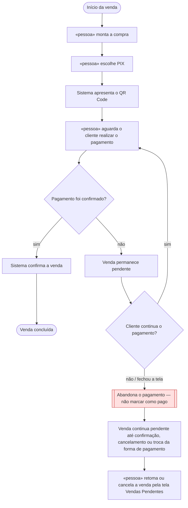

# 🗺️ Jornadas de Usuário

**Projeto:** Bleep Checkout
**Versão:** 1.1.0 · jornada principal de pagamento, alinhada ao PRD v1.1 e ao protótipo
**Última atualização:** 12/10/2026

> Esta jornada descreve o caminho do operador desde a montagem da venda até a confirmação do pagamento PIX, incluindo o comportamento quando a pessoa abandona o pagamento.
>
> Regra de negócio continua em `prd.md`; este documento descreve o caminho vivido na operação.

---

## Jornada 1 — Finalizar uma venda com PIX

**Stories:** US06 · US11
**Critérios que ela marca:** sai do site e volta · depende do tempo · depende de outra pessoa agir · pode ser abandonada

**O que decidimos sobre o nó vermelho:** se o cliente fechar a tela, desistir ou interromper o pagamento antes da confirmação do PIX, a venda não será considerada paga. Ela permanece pendente porque o fato de a tela ter sido fechada não é prova de pagamento. A venda só pode mudar para concluída quando existir uma confirmação válida do PIX ou quando o operador seguir uma forma de pagamento que tenha sido efetivamente confirmada. Assim, o sistema evita registrar uma venda como paga apenas porque o QR Code foi apresentado.

---

## Dúvidas resolvidas

As dúvidas desta jornada foram decididas e moram na fonte; aqui fica só onde cada uma foi parar.

| # | Dúvida | Decisão | Onde está |
| --- | --- | --- | --- |
| 1 | Qual o tempo máximo de uma venda PIX pendente antes de expirar? | A venda pendente não expira: só sai do estado por confirmação, cancelamento ou troca da forma de pagamento. | `prd.md`: RN17 e Fora de Escopo |
| 2 | A venda PIX pendente pode ser reaberta pelo operador? | Sim: o operador retoma ou cancela a venda pela tela Vendas Pendentes. | `prd.md`: US11 |
| 3 | Qual o link final do protótipo? | Publicado e registrado com a lista de telas. | `design-tokens.md`: seção Protótipo |

## Histórico

| Data | Versão | O que mudou |
| --- | --- | --- |
| 20/09/2026 | 1.0.0 | Jornada 1 (PIX) com o nó vermelho do abandono. |
| 12/10/2026 | 1.1.0 | Revisão da Entrega 1: a venda pendente também sai por troca da forma de pagamento (RN17), o caminho de retomada pela tela Vendas Pendentes (US11) entra na jornada e as dúvidas em aberto viram decisões com a fonte indicada. |
